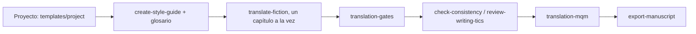

# IA-translator

[English](README.md) | [Português (Brasil)](README.pt-BR.md) | **Español** | [简体中文](README.zh-CN.md) | [日本語](README.ja.md)

Skills de Claude Code, scripts y plantillas para traducir ficción escrita en Markdown, un archivo por capítulo, con verificación mecánica y evaluación de calidad por muestreo.

## Skills

| Skill | Qué hace |
| --- | --- |
| `translate-fiction` | Traduce un capítulo o fragmento preservando la voz, el glosario y el registro, y luego verifica el resultado (subtexto, calcos, corrección de estilo, continuidad). |
| `create-style-guide` | Deriva una guía de voz a partir de muestras aprobadas. |
| `update-story-bible` | Registra los hechos de cada capítulo (nombres, términos, cronología) para alimentar el glosario. |
| `check-consistency` | Busca contradicciones entre capítulos y entre el original y la traducción. |
| `review-writing-tics` | Encuentra tics y repeticiones accidentales en el texto de destino. |
| `export-manuscript` | Compila los capítulos en epub, pdf o docx con Pandoc. |
| `translation-gates` | Compara traducción y original mediante un script: emparejamiento de archivos, paridad de párrafos y títulos, números, pasajes devueltos en el idioma de origen, truncamiento y glosario. |
| `translation-mqm` | Puntuación por muestreo al estilo MQM, con el evaluador en una sesión separada y medición del ruido. |
| `translate-end-to-end` | Modo totalmente automático: recibe solo un idioma y un archivo o carpeta, y luego traduce, ejecuta los gates, evalúa cada pasaje con un evaluador independiente, retraduce los pasajes rechazados (hasta 10 veces cada uno), comprueba la coherencia y genera un informe. Sin intervención humana. |

Las skills de creación de historias (escribir escenas, lluvia de ideas, análisis de arcos y similares) quedan fuera a propósito: quien traduce no decide la trama ni la estructura.

## Flujo



## Modo totalmente automático

```text
/translate-end-to-end language=<language-tag> path=<archivo-o-carpeta>
```

Recibe solo el idioma de destino y un archivo, o una carpeta cuyos archivos forman una misma obra. Prepara el espacio de trabajo por sí solo, traduce, ejecuta los gates, evalúa cada pasaje con un evaluador independiente, retraduce los pasajes rechazados (hasta 10 veces cada uno, conservando siempre la mejor versión), comprueba la coherencia, audita con un segundo evaluador y genera un informe. No se necesita ningún paso humano; el resultado está verificado por máquina, no revisado por personas.

## Estructura

```text
skills/              una carpeta por skill (SKILL.md + references/ que se cargan bajo demanda)
scripts/             translation_gates.py, mqm_score.py, e2e_controller.py y sus pruebas (Python 3, solo stdlib)
templates/project/   esqueleto translation/ para copiar al proyecto del libro
install.sh           enlaza las skills en ~/.claude/skills mediante symlinks
```

## Instalación

```bash
./install.sh --dry-run   # muestra lo que se haría
./install.sh             # crea los symlinks
```

Si ya existe una skill con el mismo nombre en `~/.claude/skills/`, se mueve a `~/.claude/skills/.backup-ia-translator-<fecha>` antes de reemplazarla por un enlace. No se borra nada. `CLAUDE_SKILLS_DIR` cambia el destino.

## Nuevo proyecto de traducción

```bash
cp -r templates/project/translation /ruta/del/libro/translation
```

Rellena `context/source-profile.md`, resuelve las entradas `TO DECIDE` del glosario para el idioma de destino y aprueba de dos a cuatro pares de ejemplo en la guía de estilo antes del primer capítulo.

## Scripts

```bash
python3 scripts/translation_gates.py --source <originales> --target <manuscript> --glossary <glossary.md> --glob '0*.md'
python3 scripts/mqm_score.py sample --source <originales> --target <manuscript> --glob '0*.md' -n 40 --seed 1 --out sample.json
python3 -m unittest scripts/test_translation_gates.py scripts/test_mqm_score.py scripts/test_e2e_controller.py
```

Los gates solo informan. Un número alterado hace fallar la ejecución, mientras que la terminología y los pasajes devueltos en el idioma de origen solo generan una advertencia (usa `--strict` para que fallen). Leer la muestra antes de corregir nada forma parte del proceso.
