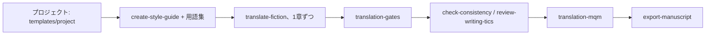

# IA-translator

[English](README.md) | [Português (Brasil)](README.pt-BR.md) | [Español](README.es.md) | [简体中文](README.zh-CN.md) | **日本語**

Markdown で書かれた小説（1章につき1ファイル）を翻訳するための Claude Code スキル、スクリプト、テンプレート集です。機械的な検証と、サンプリングによる品質評価を備えています。

## スキル

| スキル | 内容 |
| --- | --- |
| `translate-fiction` | 章や抜粋を、語りの声・用語集・文体を保ったまま翻訳し、その後に結果を検証します（言外の意味、翻訳調、校正、章をまたぐ一貫性）。 |
| `create-style-guide` | 承認済みのサンプルから文体ガイドを導き出します。 |
| `update-story-bible` | 各章の事実（名前、用語、時系列）を記録し、用語集に反映します。 |
| `check-consistency` | 章どうし、および原文と訳文のあいだの矛盾を探します。 |
| `review-writing-tics` | 訳文に紛れ込んだ無意識の癖や不要な繰り返しを見つけます。 |
| `export-manuscript` | Pandoc で各章を epub、pdf、docx にまとめます。 |
| `translation-gates` | スクリプトで原文と訳文を突き合わせます：ファイルの対応、段落・見出し数の一致、数値、原文の言語のまま残った箇所、途切れ、用語集。 |
| `translation-mqm` | MQM 形式のサンプリング評価。評価役は別セッションで動かし、スコアのばらつきも測ります。 |
| `translate-end-to-end` | 全自動モード：目標言語とファイルまたはフォルダだけを受け取り、翻訳、gates の実行、独立した評価役による全箇所の評価、不合格箇所の再翻訳（各箇所で最大10回）、一貫性チェック、レポート作成まで行います。人の手を介しません。 |

物語を作るためのスキル（場面の執筆、ブレインストーミング、人物アークの分析など）は意図的に含めていません。翻訳者は筋立てや構成を決めないためです。

## ワークフロー



## 全自動モード

```text
/translate-end-to-end language=<language-tag> path=<ファイルまたはフォルダ>
```

受け取るのは目標言語と、ファイル（または1つの作品を構成するファイルが入ったフォルダ）だけです。作業用フォルダを自動で用意し、翻訳、gates の実行、独立した評価役による全箇所の評価、不合格箇所の再翻訳（各箇所で最大10回、常に最良の版を保持）、一貫性チェック、第二の評価役による抜き取り監査を行い、レポートを出力します。人の手は不要で、結果は機械による検証済みであり、人による校閲は受けていません。

## 構成

```text
skills/              スキルごとに1フォルダ（SKILL.md + 必要時に読み込む references/）
scripts/             translation_gates.py、mqm_score.py、e2e_controller.py とそのテスト（Python 3、標準ライブラリのみ）
templates/project/   書籍プロジェクトにコピーする translation/ の雛形
install.sh           スキルを ~/.claude/skills にシンボリックリンクで配置
```

## インストール

```bash
./install.sh --dry-run   # 実行内容を表示
./install.sh             # シンボリックリンクを作成
```

`~/.claude/skills/` に同名のスキルがすでにある場合は、リンクに置き換える前に `~/.claude/skills/.backup-ia-translator-<日付>` へ移動します。何も削除されません。`CLAUDE_SKILLS_DIR` で配置先を変更できます。

## 新しい翻訳プロジェクト

```bash
cp -r templates/project/translation /path/to/book/translation
```

`context/source-profile.md` を記入し、用語集の `TO DECIDE` を訳出先の言語向けに決め、最初の章に取りかかる前に、文体ガイドで2〜4組の対訳例を承認してください。

## スクリプト

```bash
python3 scripts/translation_gates.py --source <原文ディレクトリ> --target <manuscript> --glossary <glossary.md> --glob '0*.md'
python3 scripts/mqm_score.py sample --source <原文ディレクトリ> --target <manuscript> --glob '0*.md' -n 40 --seed 1 --out sample.json
python3 -m unittest scripts/test_translation_gates.py scripts/test_mqm_score.py scripts/test_e2e_controller.py
```

gates は報告するだけです。数値が変わっていると実行は失敗となり、用語や原文の言語のまま残った箇所は警告にとどまります（`--strict` を付けると失敗扱いになります）。修正の前にサンプルを読むことも、手順の一部です。
