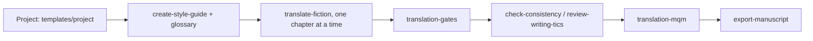

# IA-translator

**English** | [Português (Brasil)](README.pt-BR.md) | [Español](README.es.md) | [简体中文](README.zh-CN.md) | [日本語](README.ja.md)

Claude Code skills, scripts and templates for translating fiction written in Markdown, one file per chapter, with mechanical verification and sampled quality scoring.

## Skills

| Skill | What it does |
| --- | --- |
| `translate-fiction` | Translates a chapter or passage preserving voice, glossary and register, then verifies the result (subtext, calques, copy-editing, continuity). |
| `create-style-guide` | Derives a voice guide from approved samples. |
| `update-story-bible` | Records facts from each chapter (names, terms, timeline) to feed the glossary. |
| `check-consistency` | Looks for contradictions between chapters, and between source and translation. |
| `review-writing-tics` | Finds accidental tics and repetitions in the target text. |
| `export-manuscript` | Compiles the chapters into epub, pdf or docx with Pandoc. |
| `translation-gates` | Compares translation and source by script: file pairing, paragraph and heading parity, numbers, passages returned in the source language, truncation, glossary. |
| `translation-mqm` | Sampled MQM-style score, with the judge in a separate session and noise measurement. |

Story-creation skills (scene writing, brainstorming, arc analysis and the like) are left out on purpose: a translator does not decide plot or structure.

## Workflow



## Layout

```text
skills/              one folder per skill (SKILL.md + references/ loaded on demand)
scripts/             translation_gates.py, mqm_score.py and their tests (Python 3, stdlib only)
templates/project/   translation/ skeleton to copy into a book project
install.sh           symlinks the skills into ~/.claude/skills
```

## Installation

```bash
./install.sh --dry-run   # show what would be done
./install.sh             # create the symlinks
```

A skill that already exists in `~/.claude/skills/` under the same name is moved to `~/.claude/skills/.backup-ia-translator-<date>` before being replaced by a link. Nothing is deleted. `CLAUDE_SKILLS_DIR` changes the destination.

## New translation project

```bash
cp -r templates/project/translation /path/to/book/translation
```

Fill in `context/source-profile.md`, resolve the glossary's `TO DECIDE` entries for the target language, and approve two to four paired examples in the style guide before the first chapter.

## Scripts

```bash
python3 scripts/translation_gates.py --source <sources> --target <manuscript> --glossary <glossary.md> --glob '0*.md'
python3 scripts/mqm_score.py sample --source <sources> --target <manuscript> --glob '0*.md' -n 40 --seed 1 --out sample.json
python3 -m unittest scripts/test_translation_gates.py scripts/test_mqm_score.py
```

The gates only report. A changed number fails the run, while terminology and passages returned in the source language only warn (use `--strict` to fail on them). Reading the sample before fixing anything is part of the process.
