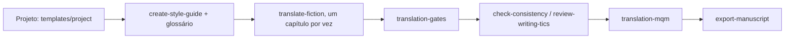

# IA-translator

[English](README.md) | **Português (Brasil)** | [Español](README.es.md) | [简体中文](README.zh-CN.md) | [日本語](README.ja.md)

Skills do Claude Code, scripts e templates para traduzir ficção escrita em Markdown, um arquivo por capítulo, com verificação mecânica e avaliação de qualidade por amostragem.

## Skills

| Skill | O que faz |
| --- | --- |
| `translate-fiction` | Traduz um capítulo ou trecho preservando voz, glossário e registro, e depois verifica o resultado (subtexto, calques, copidesque, continuidade). |
| `create-style-guide` | Deriva um guia de voz a partir de amostras aprovadas. |
| `update-story-bible` | Registra fatos de cada capítulo (nomes, termos, linha do tempo) para alimentar o glossário. |
| `check-consistency` | Procura contradições entre capítulos e entre fonte e tradução. |
| `review-writing-tics` | Encontra tiques e repetições acidentais no texto de destino. |
| `export-manuscript` | Compila os capítulos em epub, pdf ou docx com Pandoc. |
| `translation-gates` | Compara tradução e fonte por script: pareamento de arquivos, paridade de parágrafos e títulos, números, trechos devolvidos na língua de origem, truncamento, glossário. |
| `translation-mqm` | Nota por amostragem no estilo MQM, com o juiz em uma sessão separada e medição de ruído. |

As skills de criação de história (escrever cenas, brainstorm, análise de arco e similares) ficam de fora de propósito: quem traduz não decide enredo nem estrutura.

## Fluxo



## Estrutura

```text
skills/              uma pasta por skill (SKILL.md + references/ carregadas sob demanda)
scripts/             translation_gates.py, mqm_score.py e seus testes (Python 3, só stdlib)
templates/project/   esqueleto translation/ para copiar para o projeto do livro
install.sh           liga as skills em ~/.claude/skills por symlink
```

## Instalação

```bash
./install.sh --dry-run   # mostra o que seria feito
./install.sh             # cria os symlinks
```

Uma skill que já exista em `~/.claude/skills/` com o mesmo nome é movida para `~/.claude/skills/.backup-ia-translator-<data>` antes de ser trocada por um link. Nada é apagado. `CLAUDE_SKILLS_DIR` muda o destino.

## Novo projeto de tradução

```bash
cp -r templates/project/translation /caminho/do/livro/translation
```

Preencha `context/source-profile.md`, resolva as entradas `TO DECIDE` do glossário para o idioma de destino e aprove de dois a quatro pares de exemplo no guia de estilo antes do primeiro capítulo.

## Scripts

```bash
python3 scripts/translation_gates.py --source <fontes> --target <manuscript> --glossary <glossary.md> --glob '0*.md'
python3 scripts/mqm_score.py sample --source <fontes> --target <manuscript> --glob '0*.md' -n 40 --seed 1 --out sample.json
python3 -m unittest scripts/test_translation_gates.py scripts/test_mqm_score.py
```

Os gates apenas relatam. Um número alterado reprova a execução, enquanto terminologia e trechos devolvidos na língua de origem só geram aviso (use `--strict` para reprovar nesses casos). Ler a amostra antes de corrigir qualquer coisa faz parte do processo.
