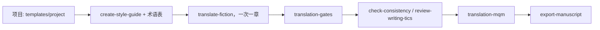

# IA-translator

[English](README.md) | [Português (Brasil)](README.pt-BR.md) | [Español](README.es.md) | **简体中文** | [日本語](README.ja.md)

用于翻译 Markdown 小说（每章一个文件）的 Claude Code 技能（skills）、脚本和模板，支持机械化校验和抽样质量评分。

## 技能

| 技能 | 作用 |
| --- | --- |
| `translate-fiction` | 翻译章节或片段，保留叙述声音、术语表和语域，并在翻译后进行校验（潜台词、翻译腔、文字校对、前后连贯性）。 |
| `create-style-guide` | 根据已确认的样本提炼风格指南。 |
| `update-story-bible` | 记录每章中的事实（人名、术语、时间线），用于充实术语表。 |
| `check-consistency` | 查找章节之间以及原文与译文之间的矛盾。 |
| `review-writing-tics` | 发现译文中无意的口头禅式表达和重复。 |
| `export-manuscript` | 使用 Pandoc 将各章编译为 epub、pdf 或 docx。 |
| `translation-gates` | 用脚本对照原文与译文：文件配对、段落与标题数量一致性、数字、仍为原文语言的段落、截断、术语表。 |
| `translation-mqm` | MQM 风格的抽样评分，评审在独立会话中进行，并衡量评分噪声。 |

创作类技能（写场景、头脑风暴、人物弧线分析等）被有意排除在外：译者不决定情节或结构。

## 工作流程



## 目录结构

```text
skills/              每个技能一个文件夹（SKILL.md + 按需加载的 references/）
scripts/             translation_gates.py、mqm_score.py 及其测试（Python 3，仅使用标准库）
templates/project/   可复制到书籍项目中的 translation/ 骨架
install.sh           通过符号链接将技能链接到 ~/.claude/skills
```

## 安装

```bash
./install.sh --dry-run   # 显示将要执行的操作
./install.sh             # 创建符号链接
```

如果 `~/.claude/skills/` 中已有同名技能，会先被移动到 `~/.claude/skills/.backup-ia-translator-<日期>`，再替换为链接。不会删除任何内容。可通过 `CLAUDE_SKILLS_DIR` 更改目标目录。

## 新建翻译项目

```bash
cp -r templates/project/translation /path/to/book/translation
```

先填写 `context/source-profile.md`，为目标语言解决术语表中的 `TO DECIDE` 条目，并在翻译第一章之前，在风格指南中确认两到四组对照示例。

## 脚本

```bash
python3 scripts/translation_gates.py --source <原文目录> --target <manuscript> --glossary <glossary.md> --glob '0*.md'
python3 scripts/mqm_score.py sample --source <原文目录> --target <manuscript> --glob '0*.md' -n 40 --seed 1 --out sample.json
python3 -m unittest scripts/test_translation_gates.py scripts/test_mqm_score.py
```

这些校验（gates）只报告问题。数字被改动会导致运行失败，而术语和仍为原文语言的段落只给出警告（使用 `--strict` 可使其也失败）。在修改任何内容之前先阅读抽样结果，是流程的一部分。
